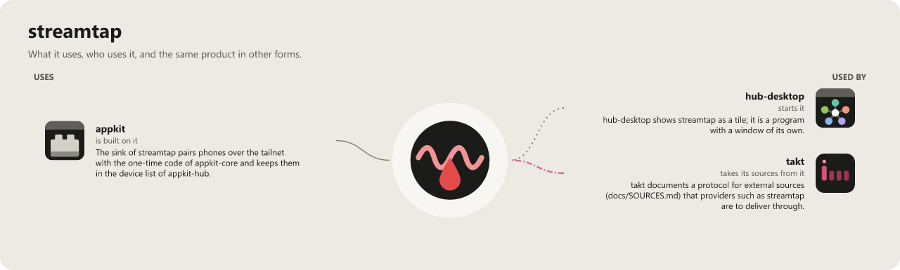

# streamtap

[](https://wkdsteve.github.io/wkd/apps/streamtap/)

Save videos that play in your browser, tapped at the point where they are
already in the clear: a browser extension hooks `SourceBuffer.appendBuffer()`
(Media Source Extensions) and hands the segments to a desktop app that writes
them to disk and muxes them into a playable file. Bit-exact, no re-encoding.

Aimed at players that do not use DRM, for personal copies where the site
allows them (public broadcasters' media libraries, lecture platforms, your own
content); verified so far in Chrome on the ARD Mediathek (hls.js). Content
protected by EME/DRM (Widevine, PlayReady, FairPlay) is detected and left
alone, by design. Respect the terms of the sites you use it on; see the
[legal note](#legal-note).

## Status

**Status: alpha.** The first release is v0.1.0; verified in Chrome only so far.

- Spike 1 (done): the extension logs what players feed into MSE. See
  [extension/README.md](extension/README.md).
- Spike 2 (done, verified in Chrome on 2026-10-31): `desktop/streamtap-sink`
  receives segments over a loopback WebSocket, writes them per SourceBuffer
  and remuxes with `ffmpeg -c copy`, reordering after seeks. See
  [desktop/README.md](desktop/README.md).
- MVP, first step (done): desktop/crates/streamtap-app, a Tauri 2 app that starts and stops the sink,
  lists the captures live and muxes, opens or deletes them. See the app section of
  [desktop/README.md](desktop/README.md).
- Browser pairing (code done, hand run in Chrome pending): the app registers a native
  messaging host for Chrome, Edge or Brave (per user, no admin), the extension pairs with
  the app after you approve it there and receives port and token by itself, and the app
  lists the tabs that hold a video so you pick the one to capture. See "Connect browser"
  in [desktop/README.md](desktop/README.md) and [extension/README.md](extension/README.md).
- Mobile (Firefox for Android, in progress, own devices only, no store): the extension has a
  source policy, on by default on the desktop too, that taps released sources and unlisted sites
  and keeps groups such as obfuscated services and social media locked until you unlock them
  (popup, *Sources*); never DRM. The popup has a start page and one page per group of settings, in English and German. A build script
  makes the Firefox variant and its `.xpi`. Two targets on the phone (code done, hand run on a phone pending): a
  recording saved on the device (`streamtap-sink replay` reads it on the PC), and the sink on the PC over your
  tailnet (Tailscale Serve, or a Headscale that issues certificates): the sink stays on loopback, each phone is
  paired with a one-time code and a key of its own and can be revoked alone; the desktop app's *Phones* panel
  sets the tailnet name, shows the pairing code as a QR code and lists and revokes the phones. See
  "Source policy", "Firefox for Android" and the two "Target" sections in [extension/README.md](extension/README.md),
  and "Phones over the tailnet" in [desktop/README.md](desktop/README.md).

Layout:

```
streamtap/
  extension/   MV3 extension (hook, content script, service worker, popup)
  desktop/     Rust workspace: streamtap-core (the logic without I/O: wire format, fMP4 structure,
               dedupe, part selection, timeline order), streamtap-testkit (fixtures of the tests),
               streamtap-sink (WebSocket receiver, segment store, mux),
               streamtap-app (Tauri 2 shell + static UI in crates/streamtap-app/ui),
               streamtap-host (native messaging host: browser <-> app relay)
  scripts/     build, install, uninstall, package-release (the release zip) and their tests
  tools/       repository checks (control-character guard, workflow rules)
  LICENSE
  README.md
```

## Download and install (Windows, from a release)

For private machines. **Not for a managed work machine** (no unsigned program is built, installed or
started there; the app is never run on it). The release is a **zip with install scripts, not a
setup.exe**, and nothing in it is code-signed.

1. Get the zip from the repository's *Releases* (or
   `gh release download <tag>`): `streamtap-<version>-x86_64-pc-windows-msvc.zip` for a release, or
   `streamtap-windows-x86_64.zip` from the pre-release **latest** (the rolling build of the newest
   green commit of `main`). In the folder you downloaded it to, **before you unpack it**, check it against
   `SHA256SUMS` of the same release and unblock it:
   `(Get-FileHash .\streamtap-*.zip -Algorithm SHA256).Hash.ToLower()` must equal the hash listed there;
   `Unblock-File .\streamtap-*.zip` removes the Mark-of-the-Web, which otherwise ends up on the
   installed programs too (the installer copies it along).
2. Install **ffmpeg** first; it is a prerequisite and not in the zip: `scoop install ffmpeg`, or put
   `ffmpeg.exe` on the `PATH`. The app looks on the `PATH` it was started with, so after installing
   ffmpeg later, restart the app; until then it shows "ffmpeg not found".
3. Unpack the zip into a **new, empty folder**, open a normal (not elevated) PowerShell in it and run
   `powershell -NoProfile -ExecutionPolicy Bypass -File .\install.ps1`. It installs for you only, without
   administrator rights, to `%LOCALAPPDATA%\streamtap` (programs in `bin\`, the extension in
   `extension\`), and adds a Start menu entry and an entry in *Settings > Apps* (uninstall).
4. **Load the extension unpacked** (Chrome has no store entry for it): `chrome://extensions`, turn on
   *Developer mode*, *Load unpacked*, pick `%LOCALAPPDATA%\streamtap\extension`.
5. Open *streamtap* from the Start menu, *Connect browser*, **Register** your browser (once), press
   **Start** (the sink; a capture needs it) and **Approve** the pairing the app shows. If no prompt
   comes within a few seconds, press *Reload* on the extension's card or *pair now* in its popup. Then
   **Capture** a tab with a video, and **Mux** the capture and open the result in the app. No command
   line is needed from here on.

**SmartScreen.** The programs and scripts are unsigned, so Windows may stop the first start of a file
that came from the internet ("Windows protected your PC": *More info*, then *Run anyway*; hence the
unblock in step 1). `-ExecutionPolicy Bypass` runs the scripts under a strict execution policy. The
checksum above is how you know the zip is the release's; it is no signature.

**Update and uninstall.** Update: close the app, run the new zip's `install.ps1`, then press *Reload* on
the extension's card at `chrome://extensions`. Uninstall: *Settings > Apps > streamtap*, or the
`uninstall.ps1` the install put in `%LOCALAPPDATA%\streamtap` (your settings and captures stay;
`-RemoveData` also removes settings, token and pairings); then remove the extension's card at
`chrome://extensions`, which stays in the browser. Details: [desktop/README.md](desktop/README.md#install).

**Not yet published.** The release and rolling workflows have not run yet: until the first `v*` tag and the
first green `main` after `rolling.yml` was added, there is no release and no `latest` pre-release to download.
The scripts are tested against stand-in programs in temp folders (`scripts/test-install.ps1`,
`scripts/test-release.ps1`), not yet with a real release.

A release is cut by pushing a `v*` tag whose version is the one in
`desktop/crates/streamtap-app/Cargo.toml`; the workflow only makes a **draft**, which is published by hand.

## Install (Windows, from the checkout)

Needs Rust (rustup) and the MSVC Build Tools. In a normal, not elevated PowerShell,
**not** from inside an MSIX-packaged app such as a Claude session or a terminal started by
one: such an app redirects `%APPDATA%`, `%LOCALAPPDATA%` and `HKCU` into its own container,
and the install would exist only there (the scripts refuse inside a Claude session).

```powershell
.\scripts\build-install.ps1              # build (scripts\build.ps1), then install for you
.\scripts\build-install.ps1 -BuildOnly   # only build desktop\target\release\*.exe
.\scripts\uninstall.ps1                  # remove the install, keep your data
.\scripts\uninstall.ps1 -RemoveData      # also the app's settings, token, pairings, WebView cache
```

Windows PowerShell 5.1 runs no script under its default execution policy (`Restricted`);
then, from the repo folder, `powershell -NoProfile -ExecutionPolicy Bypass -File
scripts\build-install.ps1` (or `pwsh` instead of `powershell`, as `:MyNative install` does).
Close a streamtap app started from the checkout first: the build refuses while
`desktop\target\release\streamtap-*.exe` runs.

`build-install.ps1` stages the build like the release zip and runs the same `install.ps1`: it copies
`streamtap-app.exe`, `streamtap-sink.exe` and `streamtap-host.exe` to `%LOCALAPPDATA%\streamtap\bin`,
the extension (load it unpacked from `extension\`) and a copy of
`uninstall.ps1` to `%LOCALAPPDATA%\streamtap`, adds a Start menu entry *streamtap* and an entry in
*Settings > Apps* (which runs that copy). It refuses while one of the programs runs from the checkout
or the install folder and names the PIDs: close the app first, it stops its sink.
Your settings, token and pairings (`%APPDATA%\io.github.wkdsteve.streamtap`) and
your captures are not touched; `uninstall.ps1` never removes a capture, not even
with `-RemoveData` (the default captures folder lies inside the settings folder,
so that folder then stays).

After the install, open *streamtap* from the Start menu. A browser you registered
from the checkout still starts the checkout's host (the script names it, the
*Connect browser* panel shows "registered for another location"): press
*Register again* there once per browser. `uninstall.ps1` removes a browser's
registration only when it points into the install folder. Details:
[desktop/README.md](desktop/README.md#install).

## Checks

CI (`.github/workflows/ci.yml`, the author's self-hosted Windows runner, on
pushes to `main` only) runs, and locally the same commands do:

```
cd desktop
cargo fmt --all --check
cargo clippy --workspace --all-targets --locked -- -D warnings
cargo test --workspace --locked
cargo audit --deny warnings     # cargo install cargo-audit
cargo deny check                # cargo install cargo-deny; policy in desktop/deny.toml
cd ..
git ls-files -z 'extension/*.js' 'extension/*.mjs' 'desktop/scripts/*.mjs' 'desktop/crates/streamtap-app/ui/*.js' | xargs -0 -n1 node --check
node extension/scripts/test-hook.mjs
node extension/scripts/test-content.mjs
node extension/scripts/test-pairing.mjs
node desktop/scripts/test-sink-link.mjs
node desktop/scripts/test-app-ui.mjs
python -m unittest discover tools
python tools/check-control-chars.py
python tools/check-workflows.py --online          # pins, runners, drafts only
actionlint                                        # syntax and expressions; winget install rhysd.actionlint
pnpm --dir tools/page-check install --frozen-lockfile; node tools/page-check.mjs tools/page-check/node_modules   # axe, light and dark: the page of the app and the popup of the extension
pwsh -NoProfile -File scripts/test-install.ps1   # install/uninstall in a temp folder, fake registry root
pwsh -NoProfile -File scripts/test-release.ps1   # the release zip: contents, checksums, install from it
Invoke-ScriptAnalyzer -Path scripts -Recurse -Severity Error, Warning   # PSScriptAnalyzer 1.24.0
```

The Rust toolchain is pinned in `desktop/rust-toolchain.toml` (rustup
installs it on first use).

The test sheets of testing.nvim (`TESTS/sheets/`, apps in `.testing.lua`) run
with `testing sheets run --sheet <name>`. One of them, `mse-capture`, loads
the extension itself into Playwright's full Chromium and checks that a real
sink writes the repository's own MSE fixture (`TESTS/sheets/fixtures/`,
generated with ffmpeg, VP9 in fragmented MP4) with the track id the hook read.
Branded Chrome refuses an unpacked extension and Playwright's Chromium does
not start on the self-hosted runner, so CI runs that sheet in the one job on a
hosted Linux VM (`extension-sheet`; `tools/check-workflows.py` allows exactly
that job off the self-hosted runner).

## Roadmap (short)

1. Spike 1: hook sees segments, timeline parses (done, see extension README).
2. Spike 2: segments streamed binary to a local Rust server, written per
   SourceBuffer, `ffmpeg -c copy` yields a playable MP4 (done).
3. MVP: desktop app with a capture list, DRM flag, mux and open (started: sink control,
   live list, mux/open/delete, browser pairing with a tab list, build-install from the
   checkout, a release zip with install scripts and a rolling build; still to do: background capture mode).
4. Later: more capture modes for DRM-free streams, tab capture, live ring
   buffer, Firefox.

## Legal note

This is a tool for personal copies of DRM-free streams. It does not and will
not circumvent technical protection measures (AT § 90c UrhG, DE § 95a UrhG,
EU 2001/29/EC Art. 6). Respect the terms of the sites you use it on.

## License

MIT, see [LICENSE](LICENSE).

<!-- connections:begin (written by the app-icons tool of the workshop; change integrations.json there, not this block) -->
## Connections



**Uses**

- [appkit](https://github.com/WKDSteve/appkit): The sink of streamtap pairs phones over the tailnet with the one-time code of `appkit-core` and keeps them in the device list of `appkit-hub`. ([picture](assets/graphs/pair/streamtap--appkit.png))

**Used by**

- [hub-desktop](https://github.com/WKDSteve/hub-desktop): hub-desktop shows streamtap as a tile; it is a program with a window of its own. ([picture](assets/graphs/pair/hub-desktop--streamtap.png))
- [takt](https://github.com/WKDSteve/takt): takt documents a protocol for external sources (`docs/SOURCES.md`) that providers such as streamtap are to deliver through. ([picture](assets/graphs/pair/takt--streamtap.png))
<!-- connections:end -->
